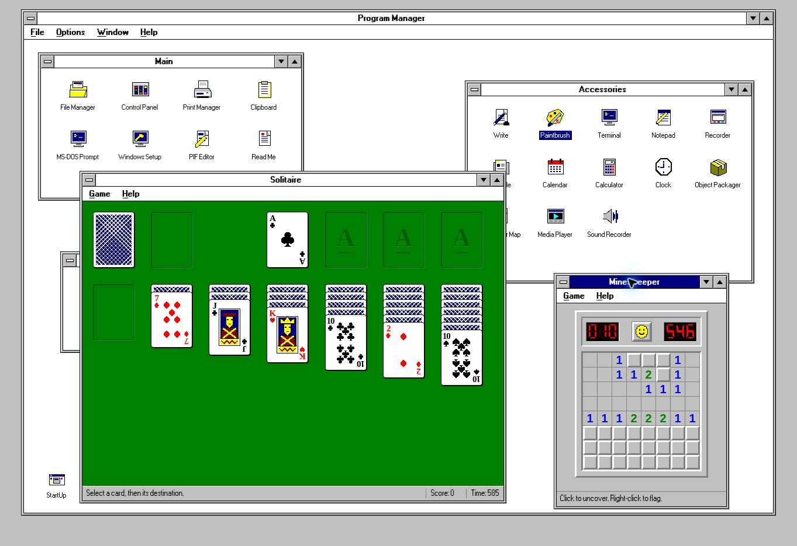

# Windows 3.1 — Browser Edition

**Live demo:** https://wieslawsoltes.github.io/Win31/ — The `Deploy to GitHub Pages` workflow publishes `dist/` on every push to `main`.

A working browser-native Windows 3.1 desktop built with HTML, CSS, and JavaScript. Program Manager hosts the original Main, Accessories, Games, and StartUp groups; applications share a persistent virtual C: drive, window manager, file dialogs, clipboard, printing, and settings.

The implementation includes **28 applications and utilities**, **seven reusable native ES-module packages**, a genuine **WebGPU renderer and compute path**, and fallbacks for browsers without GPU access. No runtime package installation, framework, external service, or bundler is required.



## Run

Requires Node.js 20 or newer for the development server and test scripts. The browser application itself is static.

```sh
npm run dev
```

Open `http://localhost:4173/`. Any ordinary static server can instead serve `dist/`. Use HTTPS or localhost when exercising browser APIs that require a secure context, including WebGPU and microphone capture.

```sh
npm run check
npm test
```

The dependency-free development server also serves an isolated browser integration harness at `/__qa/browser.html`. The harness uses an in-memory filesystem and preferences; its page and scripts are not included in the deployed public directory.

## Desktop behavior

- Draggable, resizable, overlapping windows with active/inactive captions, focus tracking, system menus, maximize/restore, minimized icons, and keyboard Move/Size.
- Program Manager groups, creation and editing of program items, command-line launching, drag/copy/move between groups, cascade, tile, icon arrangement, saved group layouts, and StartUp items.
- Shared modal dialogs with keyboard focus containment, file pickers, overwrite decisions, and asynchronous close guards for unsaved documents.
- File associations, browser file imports/downloads, a shared clipboard, and a real browser print queue.
- Device-local settings, desktop colors and patterns, fonts, simulated date/time, and blank, starfield, and Mystify screen savers.
- Keyboard commands include Alt+F4, Alt+Space, Ctrl+Esc, Alt+Tab where the host browser permits it, F1, F10, underlined menu mnemonics, and application shortcuts shown in the menus.

## Applications

| Application                 | Implemented behavior                                                                                                                                     |
| --------------------------- | -------------------------------------------------------------------------------------------------------------------------------------------------------- |
| Program Manager             | Four original default groups; editable groups/shortcuts; Run; arrangement and session layout.                                                            |
| File Manager                | Tree/list navigation, sort, multi-selection, search, rename, copy/move/delete, folders, properties, import/export.                                       |
| Control Panel               | Color, Fonts, Ports, Mouse, Desktop, Keyboard, Printers, International, Date/Time, Sound, and Drivers panels.                                            |
| Print Manager               | Spool view, pause/resume, job deletion, printer settings, browser printing.                                                                              |
| Clipboard                   | Text and file selection display, copy/paste, clipboard-file open/save, and print.                                                                        |
| MS-DOS Prompt               | Virtual-drive commands, history, completion, environment expansion, quoted paths, and output redirection.                                                |
| Windows Setup               | Installed application inventory, actual backend information, system settings and saved reports.                                                          |
| PIF Editor                  | Editable launch profiles, saved memory/preferences fields, file round trips, and supported program launching.                                            |
| Notepad                     | New/open/save, guarded closing, undo/redo, clipboard, find/replace, word wrap, font, date/time, print.                                                   |
| Write                       | Rich text, fonts, styles, paragraphs, lists, ruler, layout, zoom, search/replace, document round trips and printing.                                     |
| Paintbrush                  | Pencil/brush/eraser/fill/picker/airbrush/text/shapes; movable selection; palette; undo/redo; size/zoom; flip/rotate/invert; PNG import/export and print. |
| Terminal                    | Local loopback, communications profiles, text transmission, file capture/transfer, and profile persistence.                                              |
| Recorder                    | Timestamped application-launch macros, editing, replay speed/repeat, saved recordings and JSON import/export.                                            |
| Cardfile                    | Editable persistent cards, alphabetical index, search, duplication, file round trips, clipboard and print.                                               |
| Calendar                    | Month/day views, appointments and notes, alarms while open, configurable day display, file round trips and print.                                        |
| Calculator                  | Standard immediate calculation; scientific parser; memory; percentage; trig/angle modes; bases and bitwise operations.                                   |
| Clock                       | Analog/digital, seconds, 12/24-hour display, date, local/UTC, colors, and the simulated clock offset.                                                    |
| Object Packager             | Embedded snapshots, links and commands, appearance controls, activation, package-file round trips.                                                       |
| Character Map               | Font/Unicode selection, character previews and codes, selection buffer, keyboard navigation and copy.                                                    |
| Media Player                | Browser audio/video playback, seek, volume, repeat/speed, import/export, and a locally synthesized WAV sample.                                           |
| Sound Recorder              | Explicit microphone capture, pause/resume, waveform, playback, trimming/gain/reversal, PCM WAV output.                                                   |
| Solitaire                   | Klondike rules; draw-one/three; drag/drop; hints; undo; Standard/Vegas/None scoring; cumulative balance; saved deal; bouncing-card victory.              |
| Minesweeper                 | Safe first click, flood reveal, flags/chording, three presets/custom boards, keyboard/touch controls, timer and best times.                              |
| Windows Help                | Searchable topic navigation, keyboard reference, bookmarks, copy and print.                                                                              |
| Windows Tutorial            | Interactive guided exercises linked to the working applications.                                                                                         |
| System Configuration Editor | Shared-drive CONFIG.SYS, AUTOEXEC.BAT, WIN.INI, and SYSTEM.INI editing with save guards.                                                                 |
| Registration Info Editor    | Actual desktop setting keys, typed values, merge/search/save/export, and immediate application.                                                          |
| Dr. Watson                  | Application error collection, runtime diagnostics, and log save/export.                                                                                  |

The Main group's **Read Me** item opens the included document in Write; it is not a separate application.

## Reusable packages

| Package               | Entry points and responsibility                                                             |
| --------------------- | ------------------------------------------------------------------------------------------- |
| `@win31/core`         | `VirtualFileSystem`, `SafeStorage`, DOM/icon helpers, `Windows31` host and common services. |
| `@win31/render`       | `DesktopRenderer`, `PixelOperations`, `startScreenSaver`.                                   |
| `@win31/shell`        | `WindowManager`, `DesktopWindow`, `MenuController`, Program Manager and help utilities.     |
| `@win31/productivity` | Notepad, Write, Calculator, Calendar, Cardfile, Character Map and Clipboard.                |
| `@win31/system`       | File Manager, DOS interpreter, Control Panel, printing, Terminal and system utilities.      |
| `@win31/games`        | DOM-independent Minesweeper/Klondike engines, application UIs and victory animation.        |
| `@win31/media`        | Paintbrush, Clock, media playback, sound recording and application macros.                  |

All packages are under `dist/packages/`, have ESM `package.json` exports, and are included in the root workspace definition. Their shared application interface is documented in [the app contract](docs/APPLICATIONS.md).

```js
import { VirtualFileSystem } from "./dist/packages/core/filesystem.js";
import { PixelOperations } from "./dist/packages/render/pixel-ops.js";

const disk = new VirtualFileSystem();
await disk.ready;
disk.writeFile("C:\\DOCUMENTS\\NOTE.TXT", "Hello from Windows.");
await disk.flush();

const pixels = new PixelOperations();
const inverted = await pixels.transform(imageData, "invert");
context.putImageData(inverted, 0, 0);
pixels.dispose();
```

## Rendering and performance

`DesktopRenderer` selects WebGPU, then WebGL2, then Canvas 2D. The WebGPU path uses a WGSL render pipeline, uniform buffer, and a full-canvas triangle. Desktop patterns are rendered from exact integer pixel coordinates. Drawing is invalidation driven: idle desktop frames do not schedule continuous rendering.

Paintbrush inversion and horizontal/vertical flips use packed-RGBA WebGPU compute with 8×8 workgroups, storage buffers, explicit bounds checks, aligned copies, and mapped readback. Device loss, allocation limits, or readback failures select the exact CPU implementation. Alpha is preserved. These operations disable editing only while their asynchronous result is pending.

The animated screen savers use active-only WebGPU geometry or Canvas 2D. GPU buffers, listeners, timers, streams, and animation callbacks have disposal paths. Application windows and editable text use the DOM; Paintbrush's interactive editing surface uses Canvas 2D. This is not a claim that all DOM controls are rasterized by custom WebGPU code.

## Persistence

The virtual filesystem hydrates from IndexedDB before apps open. Mutations are synchronous in memory; durable snapshots are serialized and tracked by revision. localStorage is a fallback. Failed writes and corrupt saved data are reported, and corrupt stores are not silently replaced. `flush()` exposes a durability boundary.

Paths are case insensitive and rooted at `C:\`. Tree copies/moves and snapshot restores validate before mutation. The implementation rejects invalid paths, prohibited root operations, overlapping tree moves, malformed snapshots, and unconfirmed overwrites.

Files and settings are local to the current browser profile, device, and origin. Export files to retain independent copies. Clearing site data removes the virtual drive. Simultaneous edits in multiple tabs are not a collaborative transaction system; the most recently completed persisted snapshot can win.

## Verification

The checked-in browser report records **34 passed integration checks**, including construction of all **28 registered apps**, Program Manager groups, shared-file Notepad editing/saving, calculator button arithmetic, and zero recorded JavaScript application errors. Additional direct browser checks verified persistence across reload, File Manager associations, Paintbrush menu activation and inversion, unsaved-picture Cancel, Solitaire foundation moves/scoring/options, and Minesweeper safe first reveal.

The core test suite contains **43 passing tests** for filesystem invariants, atomic errors, asynchronous persistence, corruption/quotas, JSON preferences, exact image transforms, GPU submission contracts, fallback, device loss, screen savers and cleanup. GPU tests use controlled mocks. The browser available for verification selected **Canvas 2D**, and Paintbrush selected the **CPU** transform fallback. Actual GPU-driver/shader validation still needs a WebGPU-capable browser; no hardware performance numbers are claimed.

The optional WebMCP registrations are feature detected. The verification browser did not expose a supported registration context, so those tools were not live-validated.

## Compatibility boundary

This is a browser-native reimplementation, not an x86 emulator or a licensed installation of Microsoft Windows. Original Win16 NE executables, DOS machine-code COM/EXE programs, VxD drivers, historical OLE servers, and real serial/modem hardware are not emulated. The prompt implements commands against the virtual disk.

WRI, CRD, CAL, CLP, PIF, REG, REC, and package files use the documented browser-edition text/HTML/JSON formats. They are not blanket binary-compatible with their historical counterparts. Image output is PNG; multimedia support follows browser codecs and permissions. Host pointer speed, hardware drivers, and system-wide keyboard behavior remain controlled by the host operating system.

The visual implementation follows Windows 3.1's group model, white workspaces, centered captions, control menus, triangle buttons, bitmap typography, and constrained-palette icons. Interface icons are newly drawn and the System face is approximated with the included bitmap font. Pixel-for-pixel equivalence against original-resolution Windows 3.1 reference captures has not been established.

## References and licensing

The default program inventory and icon-caption settings follow archived Microsoft documentation. See [References](docs/REFERENCES.md) for sources. Original project code and interface glyphs are MIT licensed. The MS Sans Serif font recreations by **lou** are **CC BY-SA 3.0**, with their attribution, license notices, and source readmes included under `dist/packages/shell/fonts/`. They retain their separate license. Microsoft Windows and application names identify the historical interface being recreated; this project is not affiliated with Microsoft.

Further package details: [Core and rendering](docs/CORE.md), [System apps](docs/SYSTEM.md), [Productivity](docs/PRODUCTIVITY.md), [Media](docs/MEDIA.md), and [Games](docs/GAMES.md).
